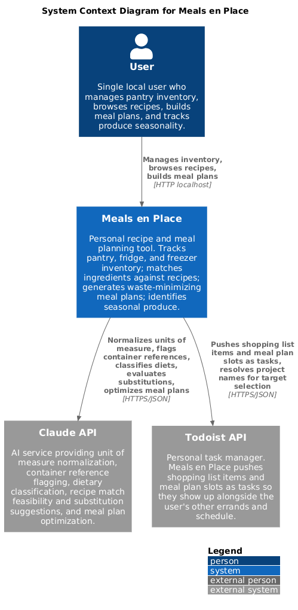
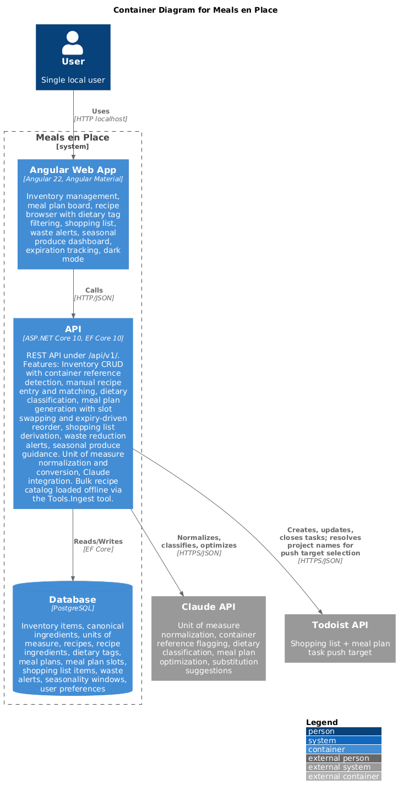
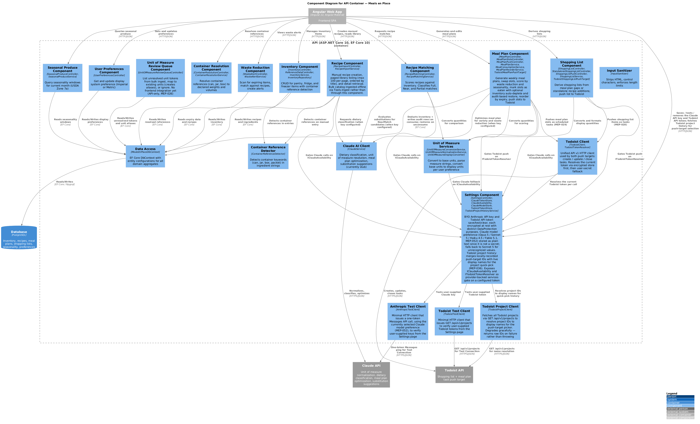
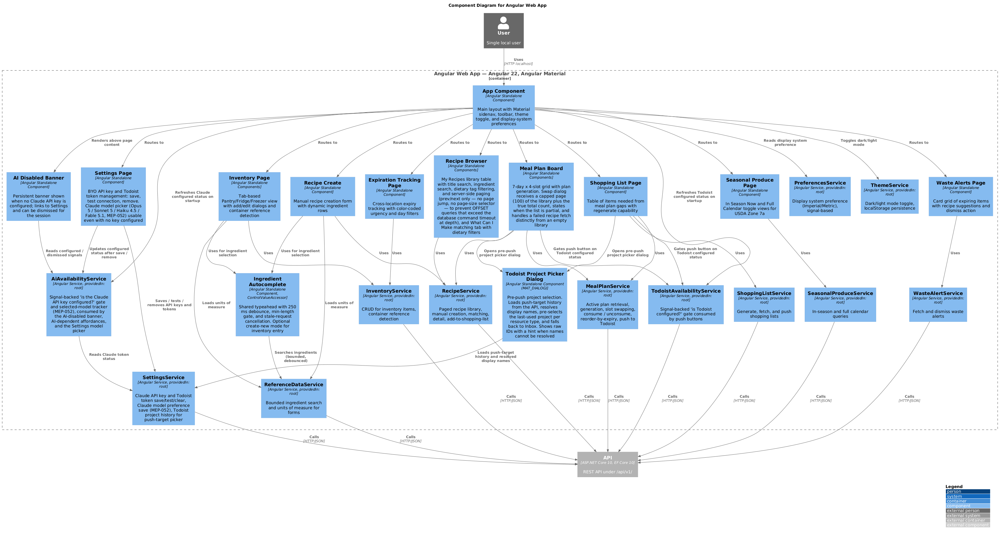

# Meals en Place

A personal recipe and meal planning tool that tracks pantry, fridge, and freezer inventory; matches available ingredients against a local recipe library; generates meal plans that minimize waste; and identifies what produce is in season. Single-user, local deployment.

## Tech Stack

- **API:** ASP.NET Core 10, Entity Framework Core 10, PostgreSQL
- **Frontend:** Angular 22, Angular Material, PWA (service worker, offline support)
- **AI:** Claude API for unit resolution, meal plan optimization and substitution suggestions (the client is a stub today; dietary tagging is rule-based). See [docs/domain.md](docs/domain.md)
- **Recipe catalog:** Bulk ingested offline from the Kaggle "Recipe Dataset (over 2M)" via `MealsEnPlace.Tools.Ingest` (see [CITATION.cff](CITATION.cff))
- **External APIs:** Todoist Unified API v1 (shopping list + meal plan task push — MEP-028 / MEP-029, migrated from REST v2 in MEP-042)
- **Testing:** xUnit, FluentAssertions, Moq (API); Vitest via `@angular/build:unit-test` (frontend)

## Getting Started

### Prerequisites

- [.NET 10 SDK](https://dotnet.microsoft.com/download)
- [Node.js 22+](https://nodejs.org/)
- [Docker Desktop](https://www.docker.com/products/docker-desktop/)

### Setup

```bash
# Start PostgreSQL
docker compose up -d

# Start the API (applies pending migrations on startup in Development only) (HTTPS on port 7274)
dotnet run --project src/MealsEnPlace.Api --launch-profile https

# In a separate terminal, start the frontend (HTTPS on port 4280)
cd src/MealsEnPlace.Web
npm install
ng serve
```

Open `https://localhost:4280` in your browser.

Migrations apply automatically when the API starts in the Development environment. Create one with `dotnet ef migrations add <Name> --project src/MealsEnPlace.Api`; apply by hand elsewhere with `dotnet ef database update`.

Swagger docs are available at `https://localhost:7274/swagger`.

### Running Tests

```bash
# API — unit and integration tests
dotnet test

# Frontend — Vitest suite
cd src/MealsEnPlace.Web
npm test

# Frontend with the 90% line-coverage gate
npm run test:coverage
```

Both suites are gated in CI at 90% line coverage. See
[src/MealsEnPlace.Web/README.md](src/MealsEnPlace.Web/README.md) for the frontend
testing conventions.

## Project Structure

```
src/
  MealsEnPlace.Api/          # ASP.NET Core Web API
    Common/                   # Shared types, unit of measure conversion/normalization, container detection
    Features/
      Inventory/              # Inventory CRUD, reference data endpoints
      MealPlan/               # Meal plan generation, slot swapping
      Recipes/                # Recipe import, matching, container resolution, dietary tags
      SeasonalProduce/        # Seasonal produce guidance (Zone 7a)
      ShoppingList/           # Shopping list derived from meal plan vs inventory
      WasteReduction/         # Waste alerts for expiring items with recipe suggestions
    Infrastructure/
      Claude/                 # Claude service (stub) and availability checks
      Data/                   # EF Core DbContext, migrations, configurations
      ExternalApis/           # Todoist client
    Models/Entities/          # Domain entities and enums
  MealsEnPlace.Web/           # Angular 22 frontend
    src/app/features/
      inventory/              # Pantry/Fridge/Freezer management
      expiration/             # Upcoming expiration dates view
      meal-plan/              # Weekly meal plan board with generate/swap
      recipes/                # Recipe browser, import, matching, dietary filters
      seasonal-produce/       # In-season produce list (Zone 7a)
      shopping-list/          # Shopping list from meal plan gaps
      waste-alerts/           # Expiry alerts with recipe suggestions
    src/app/core/             # Shared services and models
    src/app/shared/           # Reusable UI components (offline banner)
tests/
  MealsEnPlace.Unit/          # Unit tests
  MealsEnPlace.Integration/   # Integration tests (WebApplicationFactory)
docs/
  backlog/                    # Product backlog: index.md, items/, archive/
  domain.md                   # Domain rules: units, container resolution, matching, Claude
  c4/                         # PlantUML C4 architecture diagrams (L1–L3)
  spikes/                     # Research artifacts for spike stories (e.g., MEP-025)
```

## Recipe catalog: bulk ingest from Kaggle

For a larger recipe library, this project ships an offline ingest tool that imports from the [Kaggle "Recipe Dataset (over 2M)"](https://www.kaggle.com/datasets/wilmerarltstrmberg/recipe-dataset-over-2m). The dataset is licensed under [CC BY-NC-SA 4.0](https://creativecommons.org/licenses/by-nc-sa/4.0/) and is **never committed to this repository** — each user downloads their own copy from Kaggle under the dataset's terms.

### Setup

1. Create a free Kaggle account if you don't have one.
2. Download the dataset archive from the link above and extract `recipes_data.csv`.
3. Place it at `src/MealsEnPlace.Tools.Ingest/data/recipes_data.csv` (or anywhere else, and pass the path to `--csv`). This directory is gitignored so accidental commits are impossible.

### Run

```bash
# Smoke test with 500 rows, no database writes
dotnet run --project src/MealsEnPlace.Tools.Ingest --configuration Release -- \
  --csv src/MealsEnPlace.Tools.Ingest/data/recipes_data.csv \
  --dry-run \
  --max-rows 500

# Full ingest (~2 hours against the local Postgres)
dotnet run --project src/MealsEnPlace.Tools.Ingest --configuration Release -- \
  --csv src/MealsEnPlace.Tools.Ingest/data/recipes_data.csv
```

Rows whose `source` column equals `Recipes1M` are skipped automatically per the [MEP-025 spike](docs/backlog/archive/MEP-025.md) decision to respect MIT's access restriction on the underlying Recipe1M+ subset. The remaining ~1.64M rows are imported.

See [src/MealsEnPlace.Tools.Ingest/README.md](src/MealsEnPlace.Tools.Ingest/README.md) for full tool documentation and [CITATION.cff](CITATION.cff) for dataset attribution.


## Database backup

`./scripts/db-backup.sh` writes a `pg_dump` custom-format dump of the local database to `backups/` (gitignored) through `docker compose`. Nothing runs it automatically; run it before a risky migration or a bulk ingest. The script header shows the `pg_restore` command.

## Claude Code configuration

`CLAUDE.md` (root and in `src/MealsEnPlace.Api`, `src/MealsEnPlace.Web`) holds the working rules. `.claude/agents/` has an implementer and a reviewer, `.claude/skills/` the repeatable workflows, and `.claude/hooks/` the guards run by `.claude/settings.json`. `bash .claude/hooks/test-hooks.sh` tests the hooks. Hooks and scripts need bash (WSL on Windows, native on Fedora).

## Architecture

C4 diagrams below are rendered from [docs/c4/](docs/c4/) by [`scripts/render-c4.sh`](scripts/render-c4.sh), which runs PlantUML in Docker at a pinned version. The `.puml` sources are the source of truth; the `.png` files are generated artifacts committed alongside them so they render here.

After changing a `.puml`, regenerate and commit the PNGs — this is step 3 of the pre-PR checklist:

```bash
./scripts/render-c4.sh          # render and overwrite the committed PNGs
./scripts/render-c4.sh --check  # verify the PNGs match their sources; no writes
```

### Level 1 — System Context


### Level 2 — Containers


### Level 3 — API Components


### Level 3 — Web Components


## Implemented Features

- **Inventory Management** (MEP-001) -- Track items across Pantry, Fridge, and Freezer with quantity, unit of measure, and expiry dates
- **Unit of Measure Normalization** (MEP-002) -- Convert between units; Claude resolves colloquial measures
- **Container Reference Resolution** (MEP-003) -- Detect "1 can", "1 jar" and prompt for actual weight/volume
- **Recipe Catalog** (MEP-004 / MEP-026) -- Bulk ingested offline from the Kaggle 2M dataset via `MealsEnPlace.Tools.Ingest`; manual per-recipe creation through the Angular app. (TheMealDB import, the original MEP-004 source, was removed under MEP-033 once the Kaggle path was live.)
- **Dietary Classification** (MEP-005) -- Rule-based dietary tagging (Vegetarian, Vegan, GlutenFree, etc.) with library filtering
- **Recipe Matching** (MEP-006) -- "What can I make?" ranked by ingredient coverage with waste bonus and dietary tag filters
- **Meal Plan Generation** (MEP-007) -- Weekly plans optimized for waste reduction, seasonal affinity, and variety; manual slot swapping
- **Shopping List** (MEP-008) -- Auto-generated from meal plan ingredient needs vs current inventory
- **Waste Alerts** (MEP-009) -- Surfaces expiring items with matching recipe suggestions; dismiss support
- **Seasonal Produce** (MEP-010) -- USDA Zone 7a in-season produce list with full calendar view
- **Upcoming Expiration Dates** (MEP-015) -- Dashboard view of items approaching expiry
- **Material Icons** (MEP-016) -- Edit and delete icons in inventory table
- **Dark Mode** (MEP-017) -- Theme toggle with OS preference detection and localStorage persistence
- **User-Controlled Display Unit** (MEP-022) -- Inventory items display in their entry unit, not auto-converted
- **Input Sanitization** (MEP-023) -- HTML stripping, control char removal, length enforcement across all inputs
- **Progressive Web App** (MEP-021) -- Installable on mobile, offline caching, responsive sidenav, push notification stubs
- **Automated C4 Diagram Rendering** (MEP-024) -- GitHub Actions workflow renders `docs/c4/*.puml` to PNG on every push, commits the artifacts, and uploads them for 7-day download

## License

See [LICENSE](LICENSE) for details.
